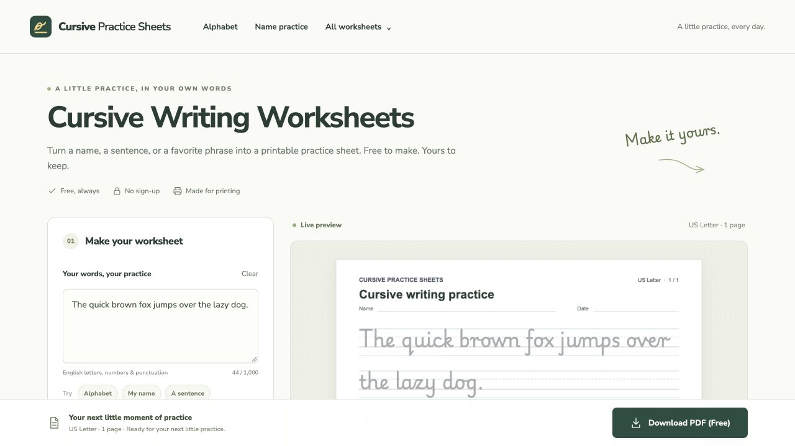

# Short Handwriting Activities: Names, Words, and Sentences

Three small activities you can print and use at home or in a classroom. Each starts with text you can copy directly into a worksheet maker, plus a simple way to vary the practice.

This guide accompanies [Cursive Practice Sheets](https://cursivepracticesheets.com/), a free browser tool for making custom handwriting PDFs. **I’m Ethan Lee, and I help maintain the product.** Choose one activity at a time and adapt the sample text to the person practicing.



## 1. A name, one part at a time

**Use:** A familiar first name or an invented example. The names below are examples, not student information.

```text
Mia
Mia Lee
My name is Mia.
```

1. Begin with the first name only. Choose **Print** or **Cursive**, whichever letter style the learner is already practicing.
2. Pick **40 pt** and **four-line guides** for a spacious model. Use **light gray** text for tracing.
3. Turn **Repeat text** on if you want the same short text repeated; it is an on/off setting.
4. Trace one model slowly. On a separate blank line or sheet, copy the name once and compare the starting letter, letter spacing, and overall size.
5. Add the surname or short sentence when another line would be useful. Keep the original capitalization.

**Variation:** Make one sheet for a real first name and another for a favorite character. Let the learner choose which to use first.

[Make a name practice sheet](https://cursivepracticesheets.com/name-tracing-worksheets/).

## 2. A short word collection

**Use:** Three to five familiar words from a book, a room, or a shared topic. This example uses things you might find outdoors:

```text
leaf
tree
bird
rain
```

1. Paste each word on its own line. Start with **32 pt** and **ruled guides**; use the preview to see whether the spacing suits the practice.
2. Choose **light gray** for tracing or **solid** for a clear model to copy from.
3. Read a word aloud, trace or copy it, then use it in a spoken sentence.
4. Compare two written words. Look for one specific feature, such as the height of `l` in “leaf” and `t` in “tree.”
5. Stop after the small set. Save a different topic for another sheet instead of filling the page with unfamiliar words.

**Variation:** Try `cat`, `cap`, and `cup` in print to compare a small change within similar words. In cursive, choose familiar words with letter joins the learner is already practicing.

## 3. A sentence with a purpose

**Use:** A short note, a line from the learner’s own story, or a sentence about something familiar. Here are two original examples:

```text
The little bird is in the tree.
Thank you for helping me today.
```

1. Use one sentence at a time. Start with **32 pt**; select **24 pt** only if the preview and the learner’s usual writing size make that comfortable.
2. Keep the first capital and final punctuation in the text.
3. Trace or copy one line. Then write the sentence separately without tracing it.
4. Compare one feature: spaces between words, the capital letter, or the full stop. Pick a single feature for the next attempt.
5. For a meaningful finish, turn the second example into a short thank-you note addressed to someone the learner chooses.

**Variation:** Replace one word with the learner’s own idea: “The little ___ is in the ___.” The worksheet text is editable, so the next sheet can use that new sentence.

[Open the sentence practice tool](https://cursivepracticesheets.com/cursive-practice-sheets/).

## Print settings checklist

Before printing several copies, check one page:

- **Paper:** Match **A4** or **US Letter** in the worksheet settings to the paper in the printer.
- **Scale:** Start with **Actual size / 100%** in the PDF print dialog. If the printer clips an edge, use its fit option and check the resulting text size on a single copy.
- **Letter style:** Choose **Print** or **Cursive**. Keep the model style consistent within one short activity.
- **Text size:** Choose **24, 32, or 40 pt** and inspect the preview before downloading.
- **Guides:** **Four-line**, **ruled**, and **blank** backgrounds offer different amounts of visual guidance.
- **Text tone:** **Light gray** suits tracing; **solid** gives a stronger model. Check that light text is visible with the printer’s current ink settings.
- **Repetition:** Toggle **Repeat text** to repeat a short model or keep just the entered content.
- **Page count:** Review every preview page. The tool accepts up to **1,000 characters** and limits a worksheet to **8 pages**; short activities are easier to check and print.
- **Download:** Select **Download PDF (Free)**, open the PDF, and print one test copy before making extras.

The worksheet PDF is generated in the browser. The tool is free to use without creating an account.

## Use and adapt this guide

Replace the sample text with words that are familiar and useful to the person practicing. Keep each activity short enough to finish comfortably. A completed sheet can be a starting point for a note or story, rather than an end in itself.

The screenshot is an existing product capture; the interface may change over time. This repository contains the written activities, a printing checklist, and existing product images.

**Maintainer:** Ethan Lee, Cursive Practice Sheets. Product and feedback information are available on the [official website](https://cursivepracticesheets.com/).
